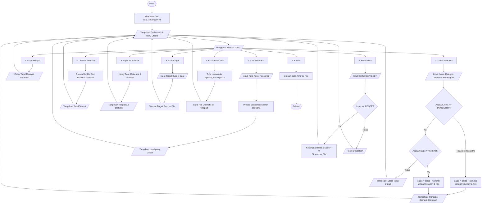

# 💰 FinTrack - Sistem Manajemen Keuangan Pribadi

Aplikasi pencatatan dan pengelolaan keuangan berbasis konsol (*Command Line Interface*) yang dibangun menggunakan bahasa pemrograman **C++ murni**. Program ini dirancang untuk memantau arus kas harian, membatasi pengeluaran bulanan melalui sistem target anggaran (*budgeting*), serta menyajikan pencarian dan pengurutan data menggunakan algoritma fundamental.

---

## 📌 Studi Kasus

> **Latar Belakang Masalah:**  
> Mahasiswa rantau atau anak kos sering kali menghadapi tantangan dalam mengelola uang saku bulanan. Pengeluaran mahasiswa sangat beragam, mencakup kebutuhan pokok harian (makanan, transportasi), kebutuhan akademik (pendidikan/buku), hingga tagihan rutin dan pengeluaran darurat. Tanpa adanya sistem pencatatan yang teratur, mahasiswa kerap mengalami kesulitan dalam memantau sisa saldo riil dan tidak menyadari kapan pengeluaran mereka telah melampaui batas wajar (*overspending*), yang berujung pada krisis finansial di akhir bulan.

**Solusi yang Diterapkan:**  
Program **FinTrack** hadir sebagai alat bantu pencatatan keuangan mandiri yang:
1. Mengelompokkan setiap transaksi ke dalam **9 kategori spesifik** (*Makanan, Transportasi, Pendidikan, Tagihan, Hutang, Liburan, Kesehatan, Pakaian, Lain Lain*).
2. Memiliki **sistem pengawasan anggaran (*budget limit*)** yang memberikan peringatan otomatis jika akumulasi pengeluaran bulanan melewati batas yang ditentukan pengguna.
3. Menyimpan seluruh mutasi transaksi secara permanen ke dalam **file teks (*File I/O*)**, sehingga data tidak hilang saat program ditutup.
4. Memudahkan penelusuran riwayat menggunakan algoritma **Sequential Search** dan evaluasi pengeluaran terbesar dengan **Bubble Sort**.

---

## 📊 Diagram Alir (Flowchart)

Berikut adalah diagram alir yang menggambarkan logika kerja program dari proses inisialisasi berkas hingga keluar:

##🛠️ Fitur-Fitur Aplikasi

1. Navigasi Panah Keyboard (TUI): Pemilihan menu menggunakan tombol panah (⬆️ Atas / ⬇️ Bawah) dan Enter tanpa mengetik angka pilihan menu secara manual.
2. Pencatatan Pemasukan & Pengeluaran: Mendukung 9 pilihan kategori belanja, format tanggal otomatis dari sistem, dan validasi saldo cukup/tidak.
3. Format Angka Rupiah: Menampilkan nominal dengan pemisah ribuan otomatis (misal Rp 500.000) dan menerima input fleksibel (dapat diketik 500.000 maupun 500000).
4. Pencarian Data (Sequential Search): Mencari transaksi berdasarkan kata kunci pada keterangan atau kategori secara linier.
5. Pengurutan Data (Bubble Sort): Mengurutkan riwayat transaksi dari nominal terbesar ke terkecil tanpa mengubah urutan tanggal pada data asli.
6. Laporan Statistik: Menyajikan ringkasan frekuensi transaksi, rata-rata pengeluaran, dan nominal transaksi terbesar.
7. Pengaturan Target Anggaran: Pengguna dapat memperbarui batas anggaran bulanan kapan saja.
8. Ekspor & Pembacaan Notepad: Mencetak laporan terformat ke berkas laporan_keuangan.txt dan langsung membukanya secara otomatis di aplikasi Notepad Windows.
9. Reset Sistem: Mengosongkan data riwayat transaksi dan mengembalikan saldo ke Rp 0 dengan proteksi konfirmasi ketik RESET.

